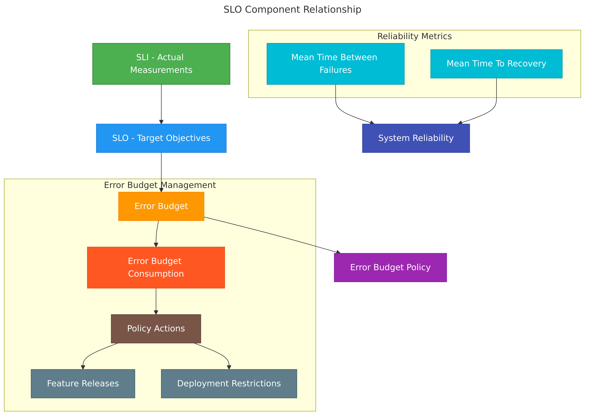
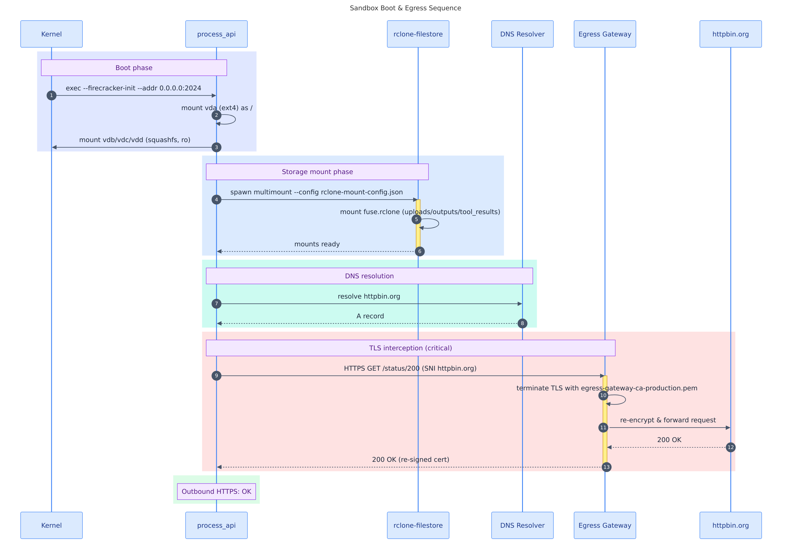

# mermaid-render

**Render [Mermaid](https://mermaid.js.org/) diagrams from Markdown to SVG, PNG, PDF, JPG, GIF, or WebP. Can read from local files, directories, or URLs.**<br>A self-contained wrapper script (compatible with **bash** and **zsh**) scans every ` ```mermaid ` fenced block in a Markdown file and renders each one to a numbered image using the [`ghcr.io/rondomondo/mermaid-render`](https://ghcr.io/rondomondo/mermaid-render) docker image, which is a thin layer on top of [`minlag/mermaid-cli`](https://hub.docker.com/r/minlag/mermaid-cli).

Point it at a local file, a whole directory, or a remote URL and it outputs numbered PNG, JPG, WEBP, GIF, SVG or PDF images next to the source (and, via pass-through, a companion markdown file with image links already applied). Suitable for local development, AI Agentic/Skill use, CI pipelines, and documentation workflows.

> **Also available as an [Agent Skill](#claude-code-skill)** -- install it to render diagrams directly from Claude Code with no terminal required. Use the `/mermaid-render` slash command or just describe what you want in plain English and your AI Agent will handle it.


## Try it now

Install the lightweight `mermaid-render` wrapper, which calls Docker for you:

```bash
docker run --rm ghcr.io/rondomondo/mermaid-render install | sh
```

Then from any directory:

```bash
# render every mermaid block in a local markdown file to PNG
mermaid-render examples/example1.md --format png

# remote URL -- fetches and renders a remote file
mermaid-render "https://alertstack.io/mermaid/examples/example1.md"
```

> To uninstall: `docker run --rm ghcr.io/rondomondo/mermaid-render uninstall | sh`

The installer is a self-contained `sh` script streamed from the image. It installs `mermaid-render` to
`/usr/local/bin` if that is writable, otherwise retries with `sudo`, and finally falls back to
`~/.local/bin` (adding it to `PATH` in your `~/.zshrc`, `~/.bashrc` or fish config if needed).
Running it again is safe. The installed wrapper defaults to the image tag it shipped with.

## No install needed - just Docker

This renders every block to `out-N.svg` and writes `out.md` with the code blocks replaced by image links:

```bash
docker run --rm -v "$PWD:/data" ghcr.io/rondomondo/mermaid-render:latest -i examples/example1.md -o out.md
```

## Install from the github repository

```bash
git clone https://github.com/rondomondo/toolbox.git && cd toolbox/mermaid-render
make install        # /usr/local/bin, else sudo, else ~/.local/bin (PATH is updated if needed)
make uninstall
make check          # verify the install worked
```

---

## Usage

```
mermaid-render                         Show help, then mmdc built-in help
mermaid-render -h | --help             Show help only
mermaid-render <input.md> [opts]       Render all diagrams in a Markdown file
mermaid-render <URL> [opts]            Fetch a remote .md (needs curl) and render its diagrams
mermaid-render <directory> [opts]      Render every .md with mermaid blocks in a directory
mermaid-render <md1> <md2> [opts]      Render multiple files (opts apply to all)
mermaid-render -- [args...]            Pass args directly to mmdc inside Docker
mermaid-render install [dir]           Copy the wrapper to ./[dir] on the host
```

```
Options:
  -f, --format <fmt>    Output format: svg (default), png, pdf, jpg, gif, webp
  -t, --theme <theme>   Mermaid theme: default, dark, forest, neutral
  -b, --bg <color>      Background colour (e.g. white, transparent, '#f5f5f5')
  -w, --width <px>      Diagram width in pixels
  -H, --height <px>     Diagram height in pixels  (uppercase -H; -h is taken by --help)
  -s, --scale <n>       Pixel density / scale factor (use 2-3 for retina PNG)
  -d, --dir <path>      Host directory to mount at /data (default: $PWD); use when the input is outside $PWD
```

---

## Examples

### SVG output (default)

```bash
mermaid-render examples/example1.md
```

### PNG at a custom size

```bash
mermaid-render examples/example1.md --format png --width 960 --height 640
```

Example output:

```
Found 4 mermaid charts in Markdown input
 ✅ ./example1.md-1.png
 ✅ ./example1.md-2.png
 ✅ ./example1.md-3.png
 ✅ ./example1.md-4.png
```

### PNG with dark theme and high pixel density

```bash
mermaid-render examples/example1.md -f png -t dark -s 3
```

### PNG with a coloured background

```bash
mermaid-render examples/example1.md --format png --width 640 --height 480 --bg '#99aacc'
```

### PDF export

```bash
mermaid-render examples/example1.md --format pdf
```

### Render a remote URL

```bash
mermaid-render "https://alertstack.io/mermaid/examples/example1.md"
mermaid-render "https://alertstack.io/mermaid/examples/example1.md" --format png --scale 2
```

Fetches the Markdown from the URL and renders all mermaid blocks -- no manual download required.

### Render an entire directory

```bash
mermaid-render examples/ --format png
```

Finds every `.md` file (up to two levels deep) containing a mermaid block and renders each one.

### Pass args directly to mmdc

```bash
mermaid-render -- --help
mermaid-render -- -i /data/examples/example1.md -o /data/out.md
```

The `--` sentinel mounts `$PWD` at `/data` and forwards all remaining args straight to `mmdc`. Passing
`-o <name>.md` this way is also how you get the companion Markdown file (see below).

---

## Output files

For an input file `examples/example1.md` rendered as PNG, the wrapper produces numbered images alongside the
input:

| File | Description |
|---|---|
| `examples/example1.md-1.png` | First rendered diagram |
| `examples/example1.md-2.png` | Second rendered diagram |
| `...` | ... |

**Naming scheme:** image files are named `<input-filename>-<N>.<format>` (e.g. `example1.md-1.png`).

The original `.md` file is **never modified**.

**Companion Markdown.** mmdc only writes a Markdown file with the code blocks replaced by ``
image links when it is given an explicit `.md` output. The wrapper does not pass one, so with the current image
(mmdc 12) `mermaid-render <file>` writes images only. Use the pass-through form to get both; images are then
named after the output (`out-N.<ext>`):

```bash
mermaid-render -- -i /data/examples/example1.md -o /data/examples/example1.rendered.md -e png
```

---

## How it works

1. `mermaid-render` mounts `$PWD` at `/data` inside the container.
2. The container runs `mmdc` (from `minlag/mermaid-cli`) via the `ghcr.io/rondomondo/mermaid-render` entrypoint, which sets `HOST_PWD` so the working directory inside the container matches your host path.
3. `mmdc` iterates over every ` ```mermaid ` block in the input file and renders each one to a numbered image file.
4. For jpg, gif and webp, which mmdc cannot produce, the wrapper renders PNG at scale 3 (unless `--scale` is given), converts each image with ImageMagick and removes the PNG.
5. A source file whose name ends `.svg.md`, `.png.md`, `.pdf.md`, `.webp.md`, `.gif.md` or `.jpg.md` is treated as a rendered companion and skipped.

---

## Debugging

Set `DEBUG=true` to enable verbose logging:

```bash
DEBUG=true mermaid-render examples/example1.md
```

---

## Sample output

Produced by running:

```bash
mermaid-render examples/example1.md --format png --width 960 --height 640 --scale 3
```

### Example 1 diagrams

| SLO Component Relationship | Sandbox Boot & Egress Sequence |
|:---:|:---:|
|  |  |
| Flowchart linking SLI → SLO → Error Budget → Policy, with MTBF/MTTR feeding into system reliability | Sequence diagram of sandbox boot phases: kernel init, storage mounts, DNS resolution, and TLS egress interception |

---

## Claude Code skill

<details>
<summary>Install the <code>/mermaid-render</code> slash command for Claude Code</summary>

This repository ships a `/mermaid-render` slash command skill for [Claude Code](https://claude.ai/code) that lets Claude render your diagrams -- no terminal required. The skill automatically detects which render path to use:

| Environment | How it renders |
|---|---|
| **Claude Code sandbox** (`IS_SANDBOX=yes`) | Uses `mmdc` directly with bundled Chromium -- no Docker needed |
| **Local / non-sandbox** | Uses `mermaid-render` backed by Docker (`ghcr.io/rondomondo/mermaid-render`) |

### What it accepts

| Input | Example |
|---|---|
| Single file | `examples/example1.md` |
| Local directory | `examples/` -- renders every `.md` with a mermaid block |
| URL (file) | `https://alertstack.io/mermaid/examples/example1.md` |

### Invoking the skill

Use the slash command directly:

```
/mermaid-render examples/example1.md
/mermaid-render examples/example2.md --format webp --scale 3
/mermaid-render examples/ -f png -t forest
/mermaid-render "https://alertstack.io/mermaid/examples/example2.md"
```

Or just describe what you want in natural language -- Claude will invoke the skill automatically:

> *"I've got a folder of documents at examples/ that has some architecture diagrams in it -- can you render them all?"*
>
> *"Export examples/example2.md as a PNG at double resolution"*
>
> *"I have some sequence diagrams and architecture charts in a markdown doc. Can you turn them into images?"*

### Installing the skill

#### Option A -- upload ZIP to Claude.ai (web UI)

1. Download or build the skill ZIP:

   ```bash
   cd mermaid-render
   zip -r mermaid-render-skill.zip SKILL.md mermaid-render examples references evals
   ```

2. Open [claude.ai/code](https://claude.ai/code), go to **Settings > Skills**, and upload `mermaid-render-skill.zip`.

3. The `/mermaid-render` command becomes available in any Claude Code conversation.

#### Option B -- install locally via `make`

Copy the skill files into your project's `.claude/skills/` directory so Claude Code picks them up automatically:

```bash
# from inside the mermaid-render directory
make sync-skill
```

This syncs `SKILL.md`, `mermaid-render`, `examples`, `references`, and `evals` to:

```
~/Code/agent-skills-toolbox/skills/mermaid-render/
```

Override the target directory with `SKILLS_DIR`:

```bash
make sync-skill SKILLS_DIR=/path/to/your/project/.claude/skills/mermaid-render
```

#### Option C -- copy manually

```bash
mkdir -p .claude/skills/mermaid-render
cp -R SKILL.md mermaid-render references .claude/skills/mermaid-render/
```

</details>

---

## Tips

- Use `--scale 2` or `--scale 3` for retina/HiDPI exports.
- Combine `--bg transparent` with SVG or PNG output for diagrams you embed in dark-mode docs.
- Run `mermaid-render --` to pass flags directly to `mmdc` for options not covered by this wrapper.
- Run `mermaid-render -h` at any time to print the built-in help.
- Run `mermaid-render` with no arguments to print the wrapper help followed by mmdc's own help.


---

## Docker targets

```bash
make build                     # Bump VERSION, build a single-arch image for local testing
make push                      # Build multi-platform (see PLATFORMS) and push :VERSION and :latest
make release                   # Bump patch version, then push
make release-rc                # Push VERSION-rc.1 without bumping VERSION or moving :latest
make retag FROM=latest TAG=v0.1.1   # Re-tag an existing remote image
make docker-shell              # Drop into a shell in the container
make inspect                   # Show the platforms in the remote :latest manifest
make test                      # Render TEST_INPUT as SVG and PNG to verify the pipeline
make doctor                    # Show environment info useful for bug reports
make clean                     # Remove local image tags (clean-builder removes the buildx builder)
```

Options:

```bash
make push NO_CACHE=1           # bust the build cache
make push REGISTRY=docker.io   # push somewhere else
```

`make push` and `make release` publish to the registry and need `docker login` first.

---

## Requirements

- **Docker** installed and running locally
- **bash** (3.2+) or **zsh**

